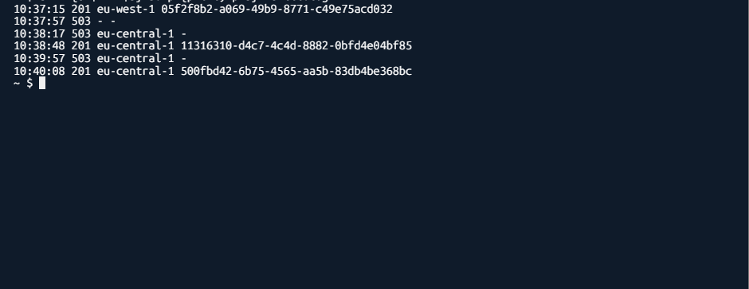
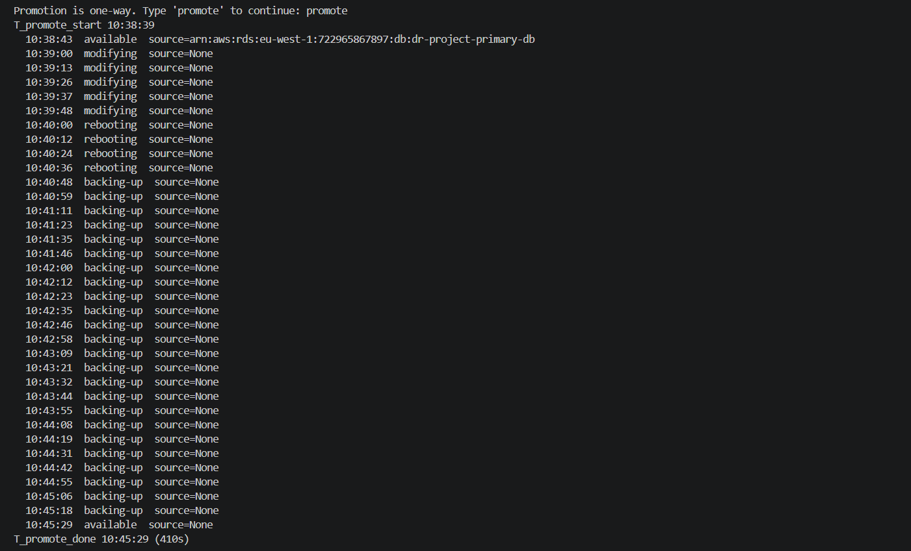

# Design decisions

- **State:** bootstrap-managed S3 bucket (versioned, encrypted, no public access) with native S3 locking (`use_lockfile`, no DynamoDB). It lives in the primary region, so a primary outage blocks `terraform apply`. Known limitation: replicating the bucket to the standby region would fix this, but it isn't set up yet.
- **Networking:** public subnets route directly to the IGW (no NAT). ECS tasks use public IPs and only accept traffic from the ALB security group. ALBs can only send to the container port on tasks. Database subnets have no internet route.
- **Images:** ECR lives in the primary root and replicates to eu-central-1. `scripts/deploy.sh` builds Bridge (API and web app in one image) from its two repos, tags it with both commits, and waits until eu-central-1 has the identical image before applying, so both regions always run the same build. Destroying primary deletes its repo, so the script recreates it and pushes before the main apply.

## Database

RDS-managed master passwords block cross-region Postgres replicas, so the password is generated by Terraform (random_password). Each region stores it in its own Secrets Manager secret that points at its own database. I dropped a replicated secret: after a teardown AWS keeps the replica's name reserved in the standby region, which broke rebuilds, and the replica carried the primary DB's address. The password is also in Terraform state, which sits in an encrypted, private S3 bucket. Production would rotate it or use IAM authentication.

The standby is a read replica, so it refuses writes. The API returns 503 `read_only_mode` for those, while reads and health checks keep working. The schema is created by a one-off ECS task on primary (`scripts/migrate.sh`), never at app startup, because the standby can't run DDL.

`POST /transfers` is idempotent: `idempotency_key` is unique and the insert uses `ON CONFLICT DO NOTHING`, so concurrent retries create exactly one transfer.

The API connects to RDS with `sslmode=verify-full`, and the image includes the RDS CA bundle, so the server's certificate and hostname are verified.

## Disaster recovery summary

- **Write RTO:** 66s (Drill B) and 86s (Drill A), from failure to the first write accepted by `eu-central-1`. Most of it is DNS failover, which took 35 to 90s across all four drills.
- **Promotion:** the standby became writable 9s after the promote call in Drill B, and within 20s in Drill A.
- **RPO:** 0 observed, with all 37 acknowledged writes found on the promoted database. Replica lag was 0 to 1s under steady writes, and that lag, not zero, is the design bound.
- **Limits:** one client writing about once per second, and only the app tier was failed. Primary's database kept running, so the replica could catch up before promotion. In a real regional outage, writes inside the lag window could be lost.

## Disaster Recovery Drills (App Tier)

**Method:** Primary ECS service scaled to 0 with `scripts/simulate-failure.sh fail`. Observed from AWS CloudShell (clean resolver), polling `https://dr.qossim005.online/health` every 2s. Route 53 failover records: 30s HTTPS health check (failure threshold 3) plus `evaluate_target_health` on the alias. All times UTC.

### Drill 2 (recorded)

| Event | Time (UTC) | Elapsed |
|---|---|---|
| T0: failure injected | 10:54:49 | n/a |
| Last `eu-west-1` response | 10:55:05 | +16s |
| First failed request | 10:55:07 | +18s |
| First `eu-central-1` response | 10:55:39 | **+50s** |
| Restore started | 10:55:57 | n/a |
| First `eu-west-1` response (failback) | 10:56:39 | +42s |

- **DNS failover (first `eu-central-1` response):** 50s from injection.
- **User-visible outage:** ~32s of failed requests (10:55:07 to 10:55:36).
- **Failback:** 42s with no failed requests.

### Drill 1 vs Drill 2

| Metric | Drill 1 | Drill 2 |
|---|---|---|
| Failover | ~90s | 50s |
| Failback | ~2m 14s | 42s |

The runs differ, so I report both and treat DNS failover as a range of 50 to 90s. Write RTO, which includes the database, is under Database drills below.

### Observations
- Failed requests during the flip were 503s from the primary ALB, whose target group was empty.
- Failover (50s) was faster than three failed 30s health checks would allow. Likely cause: `evaluate_target_health` on the alias marks the primary unhealthy as soon as its target group is empty. Not yet verified.
- At the start of Drill 2, `eu-central-1` answers appear because primary was still recovering from the previous restore. Failure was injected after it stabilised.

### Caveats
- App tier only: these drills ran before the database existed, so there was no promotion step. Write RTO is under Database drills below.
- Clients behind caching resolvers can add up to ~60s (alias TTL).
- Local WSL DNS gave inconsistent answers, so only CloudShell results are used.
- RPO wasn't measurable without a data layer. It was measured later, under Database drills below.

## Disaster Recovery Drills (Database)

**Method:** A probe in AWS CloudShell sent one `POST /transfers` per second through `https://dr.qossim005.online`, logging status code, serving region and transfer id. Primary was failed with `scripts/simulate-failure.sh fail` (ECS scaled to 0), then the standby replica was promoted with `scripts/promote-replica.sh`. All times UTC.

### Drill B (recorded, 9 Nov)

| Event | Time (UTC) | Elapsed |
|---|---|---|
| T0: failure injected | 10:37:42 | n/a |
| Last write accepted by `eu-west-1` | 10:37:56 | +14s |
| First `eu-central-1` response (503 `read_only_mode`) | 10:38:17 | +35s |
| Promotion started | 10:38:39 | +57s |
| First write accepted by `eu-central-1` | 10:38:48 | **+66s** |
| Database restart during promotion | 10:39:57 to 10:40:07 | 10 failed requests |

- **Write RTO:** 66s from injection.
- **Promotion to writable:** 9s after the promote call. RDS reports `available` after 410s, once a reboot and an automatic backup finish, and writes work throughout except during the restart.
- **RPO:** 0 observed. All 37 writes acknowledged by primary were readable on the promoted database. The design bound is the async replica lag, not zero.
- **Failed writes:** 55 (17 while primary's ALB was empty, 28 while the standby was read-only, 10 during the restart).

RPO check in CloudShell: each of the 37 transfer ids primary acknowledged was fetched from the promoted database. Result: checked 37 primary writes, 0 missing.

### Drill A (6 Nov)

| Event | Time (UTC) | Elapsed |
|---|---|---|
| T0: failure injected | 16:21:27 | n/a |
| Last write accepted by `eu-west-1` | 16:21:44 | +17s |
| Promotion started | 16:22:12 | +45s |
| Standby stopped replicating | by 16:22:32 | +65s |
| First write accepted by `eu-central-1` | 16:22:53 | **+86s** |
| Database restart during promotion | 16:23:31 to 16:23:40 | 9 failed requests |

- **Write RTO:** 86s. Promotion started before DNS switched, so the first `eu-central-1` response was already a successful write, with no read-only window.
- **Failed writes:** 68 (59 during the DNS switch, 9 during the restart).
- **RPO:** not checked, because the stack was torn down before the check ran.

### Drill A vs Drill B

| Metric | Drill A (6 Nov) | Drill B (9 Nov) |
|---|---|---|
| Promotion started | Before DNS switched (+45s) | After the standby answered (+57s) |
| First `eu-central-1` response | +86s | +35s |
| Writes back | +86s | +66s |
| Read-only window | None | 31s |
| Failed writes | 68 | 55 |

### Observations
- RTO is set by DNS failover, not the database. Promotion made the standby writable 9s after the call in Drill B and within 20s in Drill A, while the DNS switch took 35 to 86s.
- When promotion waits for the switch, the standby serves reads and refuses writes with 503 `read_only_mode`. In Drill B that lasted 31s, 22s of which was the operator deciding to promote. Automating promotion would remove that delay.
- The app needed no restart or config change. Each region's secret already points at its own database, and the connection pool reconnected after the restart.
- Replica lag under steady writes was 0 to 1s (CloudWatch `ReplicaLag`). Readings while primary is idle climb 60s per minute and are excluded, because Postgres measures lag as time since the last replayed change.

### Caveats
- Only the app tier was failed, so primary's database stayed up. In a real regional outage it would be unreachable, and writes in flight could be lost, bounded by replica lag.
- One client writing about once per second. Higher write rates could show a non-zero RPO.
- Promotion is one-way. Real failback means rebuilding primary as a replica of the promoted database. Here the stack was torn down and rebuilt instead.
- After promotion, `envs/secondary` still describes a read replica, so it isn't applied again before teardown.